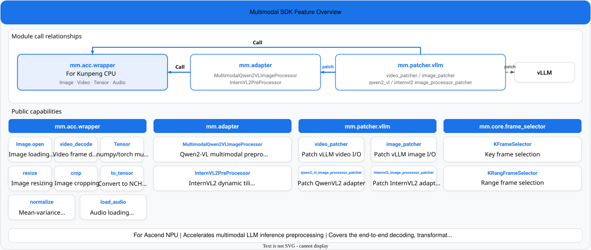

<h1 align="center">Multimodal SDK</h1>

[![Zread](https://img.shields.io/badge/Zread-Ask_AI-_.svg?style=flat&color=0052D9&labelColor=000000&logo=data%3Aimage%2Fsvg%2Bxml%3Bbase64%2CPHN2ZyB3aWR0aD0iMTYiIGhlaWdodD0iMTYiIHZpZXdCb3g9IjAgMCAxNiAxNiIgZmlsbD0ibm9uZSIgeG1sbnM9Imh0dHA6Ly93d3cudzMub3JnLzIwMDAvc3ZnIj4KPHBhdGggZD0iTTQuOTYxNTYgMS42MDAxSDIuMjQxNTZDMS44ODgxIDEuNjAwMSAxLjYwMTU2IDEuODg2NjQgMS42MDE1NiAyLjI0MDFWNC45NjAxQzEuNjAxNTYgNS4zMTM1NiAxLjg4ODEgNS42MDAxIDIuMjQxNTYgNS42MDAxSDQuOTYxNTZDNS4zMTUwMiA1LjYwMDEgNS42MDE1NiA1LjMxMzU2IDUuNjAxNTYgNC45NjAxVjIuMjQwMUM1LjYwMTU2IDEuODg2NjQgNS4zMTUwMiAxLjYwMDEgNC45NjE1NiAxLjYwMDFaIiBmaWxsPSIjZmZmIi8%2BCjxwYXRoIGQ9Ik00Ljk2MTU2IDEwLjM5OTlIMi4yNDE1NkMxLjg4ODEgMTAuMzk5OSAxLjYwMTU2IDEwLjY4NjQgMS42MDE1NiAxMS4wMzk5VjEzLjc1OTlDMS42MDE1NiAxNC4xMTM0IDEuODg4MSAxNC4zOTk5IDIuMjQxNTYgMTQuMzk5OUg0Ljk2MTU2QzUuMzE1MDIgMTQuMzk5OSA1LjYwMTU2IDE0LjExMzQgNS42MDE1NiAxMy43NTk5VjExLjAzOTlDNS42MDE1NiAxMC42ODY0IDUuMzE1MDIgMTAuMzk5OSA0Ljk2MTU2IDEwLjM5OTlaIiBmaWxsPSIjZmZmIi8%2BCjxwYXRoIGQ9Ik0xMy43NTg0IDEuNjAwMUgxMS4wMzg0QzEwLjY4NSAxLjYwMDEgMTAuMzk4NCAxLjg4NjY0IDEwLjM5ODQgMi4yNDAxVjQuOTYwMUMxMC4zOTg0IDUuMzEzNTYgMTAuNjg1IDUuNjAwMSAxMS4wMzg0IDUuNjAwMUgxMy43NTg0QzE0LjExMTkgNS42MDAxIDE0LjM5ODQgNS4zMTM1NiAxNC4zOTg0IDQuOTYwMVYyLjI0MDFDMTQuMzk4NCAxLjg4NjY0IDE0LjExMTkgMS42MDAxIDEzLjc1ODQgMS42MDAxWiIgZmlsbD0iI2ZmZiIvPgo8cGF0aCBkPSJNNCAxMkwxMiA0TDQgMTJaIiBmaWxsPSIjZmZmIi8%2BCjxwYXRoIGQ9Ik00IDEyTDEyIDQiIHN0cm9rZT0iI2ZmZiIgc3Ryb2tlLXdpZHRoPSIxLjUiIHN0cm9rZS1saW5lY2FwPSJyb3VuZCIvPgo8L3N2Zz4K&logoColor=ffffff)](https://zread.ai/Ascend/MultimodalSDK)
[![DeepWiki](https://img.shields.io/badge/DeepWiki-Ask_AI-_.svg?style=flat&color=0052D9&labelColor=000000&logo=)](https://deepwiki.com/Ascend/MultimodalSDK)

## ✨ Latest Updates

🔹 **[2026.09.30]**: 🚀 [Multimodal SDK 26.2.0 Release is now available](https://atomgit.com/Ascend/MultimodalSDK/releases/v26.2.0). 
🔹 **[2026.07.31]**: 🚀 [Multimodal SDK 26.1.0 Release is now available](https://atomgit.com/Ascend/MultimodalSDK/releases/v26.1.0). 
🔹 **[2026.04.25]**: 🚀 [Multimodal SDK 26.0.0 Release is now available](https://atomgit.com/Ascend/MultimodalSDK/releases/v26.0.0). 
🔹 **[2025.12.30]**: 🚀 Multimodal SDK is released as open source. 

## ℹ️ Introduction

Multimodal SDK is a multimodal LLM inference preprocessing acceleration suite optimized for Ascend devices. It provides commonly used interfaces for image, video, and audio processing, covering preprocessing processes such as image and video loading and decoding, resizing, cropping, and audio loading. It also supports conversion between multiple open-source data structures and accelerator library data structures, helping you quickly onboard and migrate multimodal inference applications.

## ⚙️ Features

| Feature | Description | Interface |
| --- | --- | --- |
| [Image Processing](./docs/en/04_user_guide/user_guide.md#image-processing) | Supports image reading, resizing, and cropping, as well as NumPy data conversion for image preprocessing scenarios in multimodal models. | [Link](./docs/en/05_api/function_reference.md) |
| [Video Processing](./docs/en/04_user_guide/user_guide.md#video-processing) | Supports decoding by specified frame ID or uniform sampling by target frame count, and returns a list of `Image` objects that can be further processed. | [Link](./docs/en/05_api/function_reference.md) |
| [Audio Processing](./docs/en/04_user_guide/user_guide.md#audio-processing) | Supports audio loading from a single file, a file list, or a directory, and allows you to specify the resampling rate. | [Link](./docs/en/05_api/function_reference.md) |
| [Inference Framework Patches](./docs/en/05_api/patcher.md) | Provides vLLM framework patches to integrate acceleration capabilities into existing inference processes. | [Link](./docs/en/05_api/patcher.md) |

## 🚀 Quick Start

Multimodal SDK provides a Docker-based quick start process that helps you start the environment, load variables, and verify your first Python example. For details, see the [Quick Start](./docs/en/02_quickstart/quickstart.md).

If you need to modify the source code and rebuild it, see the [Contribution Guide](./CONTRIBUTING.md).

## 📦 Installation Guide

Multimodal SDK supports offline installation, image installation, and source code installation. For details, see the [Installation Guide](./docs/en/03_installation_guide/installation_guide.md).

## 📘 User Guide

Multimodal SDK provides examples and operation guidance for the basic preprocessing interfaces in typical scenarios: images, videos, and audio. For details, see [Examples and Guidance](./docs/en/04_user_guide/user_guide.md).

For API descriptions, see the following documents.

| Document | Description |
| --- | --- |
| [Function Reference](./docs/en/05_api/function_reference.md) | Describes interfaces such as `Tensor`, `Image`, `video_decode`, and `load_audio`. |
| [Patcher](./docs/en/05_api/patcher.md) | Describes the vLLM framework preprocessing acceleration patches. |
| [Python API Reference](./docs/en/05_api/README.md) | Data type enumerations and the entry point to the API documentation. |

## 🗺️ Roadmap

[Roadmap (2026Q3)](https://atomgit.com/Ascend/MultimodalSDK/issues/40)

## 🔀 Version Maintenance Strategy

| Version | Maintenance Strategy | Current Status | Release Date | Next Status | EOL Date |
| --- | --- | --- | --- | --- | --- |
| master | Long-term support | Development | Under active development and not yet released | Continuous development | - |
| v26.2.0 | Regular branch | Maintenance | 2026-09-30 | Expected to enter unsupported status on March 31, 2027. | 2027-03-31 |
| v26.1.0 | Regular branch | Maintenance | 2026-07-31 | Expected to enter unsupported status on January 31, 2027. | 2027-01-31 |
| v26.0.0 | Regular branch | Maintenance | 2026-04-25 | Expected to enter unsupported status on October 25, 2026. | 2026-10-25 |

## 🛠️ Contribution Guide

You are welcome to contribute to the project. For the contribution process and guidelines, see the [Contribution Guide](./CONTRIBUTING.md).

## ⚖️ Related Notices

🔹 [Release Notes](./docs/en/release_notes_mm.md) 
🔹 [Security Hardening](./docs/en/06_references/security_hardening.md) 
🔹 [License Statement](./LICENSE.md) 
🔹 [Documentation License Statement](./docs/LICENSE) 
🔹 [Disclaimer](./docs/en/01_introduction/02_disclaimer.md) 
🔹 [Third-Party Open-Source Software Notice](./Third_Party_Open_Source_Software_Notice)

## 🤝 Suggestions and Communication

You are welcome to raise questions and exchange ideas in the following ways.

| Resource | Description |
| :-- | :-- |
| [FAQ](./docs/en/06_references/faq.md) | Answers to frequently asked questions and usage inquiries. |
| [Create an Issue](https://atomgit.com/Ascend/MultimodalSDK/issues/create/choose) | Submit bugs, feature requests, or suggestions. |
| [Community Tasks](https://atomgit.com/Ascend/MultimodalSDK/issues) | View and claim community tasks. |
| [Meeting Calendar](https://meeting.ascend.osinfra.cn/?sig=sig-MindSeriesSDK) | Schedule of regular community meetings and activities. |
