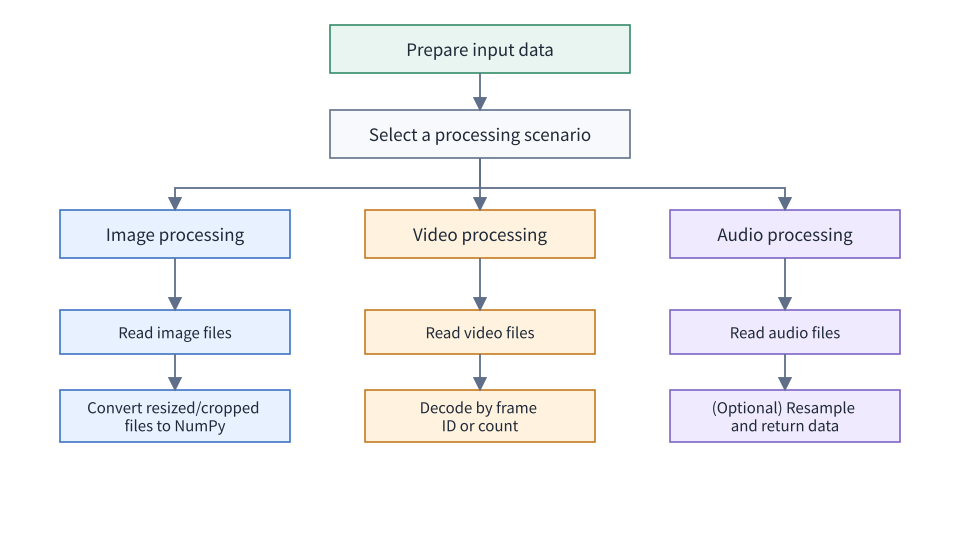
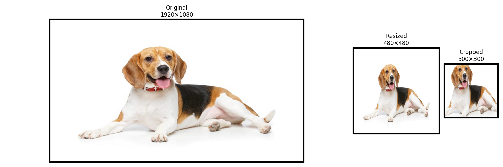
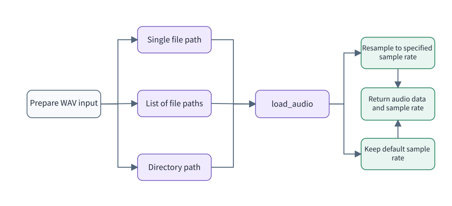

# Examples and Guidance

This document uses three typical scenarios of images, videos, and audio to explain how to use the basic preprocessing interfaces of Multimodal SDK. The overall process is as follows:



## Before You Start

- This document applies to the latest release of Multimodal SDK. You are advised to use Python 3.10 or 3.12.
- First, complete [Quick Start](../02_quickstart/quickstart.md) or [Installation Guide](../03_installation_guide/installation_guide.md), and confirm that `import mm` succeeds.
- The image example requires `matplotlib`, which is used only to display the processing results: `pip3 install matplotlib`.
- The permissions on the example files must not be higher than 640. Currently, images support jpg/jpeg, videos support mp4, and audio supports wav.
- You are advised to run the examples in this document in Jupyter, where you can view the processing results directly. The following script completes "start the container → install dependencies → start Jupyter" in one step (the container image and device mounts are the same as those in [Quick Start](../02_quickstart/quickstart.md), and the device number is adjusted according to the actual NPU):

    ```bash
    # 1. Start the container (if it already exists, delete it first: docker stop multimodal_container && docker rm multimodal_container)
    docker run \
        --name multimodal_container \
        --device /dev/davinci0 \
        --device /dev/davinci_manager \
        --device /dev/devmm_svm \
        --device /dev/hisi_hdc \
        -v /usr/local/dcmi:/usr/local/dcmi \
        -v /usr/local/bin/npu-smi:/usr/local/bin/npu-smi \
        -v /usr/local/Ascend/driver/lib64:/usr/local/Ascend/driver/lib64 \
        -v /usr/local/Ascend/driver/version.info:/usr/local/Ascend/driver/version.info \
        -v /etc/ascend_install.info:/etc/ascend_install.info \
        -p 8888:8888 \
        -itd multimodalsdk:26.2.0-cann9.2.0-torch_npu2.10.0.post4-910b-ubuntu22.04-py3.12-aarch64 bash

    # 2. Access the container, install dependencies, and start Jupyter
    docker exec -it multimodal_container bash -c '
    pip3 install --no-cache-dir jupyterlab matplotlib
    export MULTIMODAL_SDK_HOME="/usr/local/multimodal"
    source ${MULTIMODAL_SDK_HOME}/script/set_env.sh
    jupyter lab --no-browser --port=8888 --ip=0.0.0.0 --allow-root
    '
    ```

    After startup, the terminal prints the access address (including the token), in the form `http://127.0.0.1:8888/lab?token=xxxx`. Open this address in the browser on the host (the container has mapped the port through `-p 8888:8888`. Therefore, you can directly access `http://127.0.0.1:8888/lab?token=xxxx` on the local machine). Then create a notebook, copy the example code from this document into it, and run it.

## Image Processing

The following is a simple example for reference. It reads an image with the `Image` class of Multimodal SDK, resizes and crops the image, and finally converts it into a standard NumPy array to show the effect of the preceding operations.


```python
import mm  # Import the Multimodal SDK package
import matplotlib.pyplot as plt  # Use this only for image display
from matplotlib.patches import Rectangle  # Use this only for image display, to draw the rectangle frames

dog_img = mm.Image.open("/data/test.jpg")  # Construct an Image variable from a real file through the Multimodal Image class (note that the file permissions cannot exceed 640)
dog_resized_img = dog_img.resize((480, 480), mm.Interpolation.BICUBIC, mm.DeviceMode.CPU)  # Resize the image in CPU mode using the bicubic interpolation algorithm
dog_cropped_img = dog_resized_img.crop(100, 100, 300, 300, mm.DeviceMode.CPU)  # Crop the resized image in CPU mode

resized_np = dog_resized_img.numpy()  # Convert the resized image into a NumPy array for later display
cropped_np = dog_cropped_img.numpy()  # Convert the cropped image into a NumPy array for later display
original_dog = dog_img.numpy()  # Convert the constructed original image into a NumPy array for later display

# The following code displays the images
h_orig, w_orig = original_dog.shape[:2]
h_resize, w_resize = resized_np.shape[:2]
h_crop, w_crop = cropped_np.shape[:2]

fig, axes = plt.subplots(1, 3, figsize=(15, 5),
                         gridspec_kw={'width_ratios': [w_orig, w_resize, w_crop]})

# Prepare the data
images = [original_dog, resized_np, cropped_np]
titles = [
    f"Original\n{w_orig}×{h_orig}",
    f"Resized\n{w_resize}×{h_resize}",
    f"Cropped\n{w_crop}×{h_crop}"
]

# Display in a loop
for ax, img, title in zip(axes, images, titles):
    ax.imshow(img)
    ax.set_title(title)
    ax.axis('off')
    rect = Rectangle((0, 0), 1, 1, transform=ax.transAxes, linewidth=3, edgecolor='black', facecolor='none', clip_on=False)
    ax.add_patch(rect)

plt.tight_layout()
plt.show()
```



## Video Processing

The video decoding interface of Multimodal SDK supports two ways to set parameters, and you can choose as needed. The type of `frame_indices` is `set`, which indicates the set of video frame IDs you expect to decode. `sample_num` indicates the target number of frames to sample evenly when `frame_indices` is empty. If `frame_indices` is not empty, the interface decodes based on the specified frame IDs first, and `sample_num` no longer takes effect.

- If you pass a set of **video frame IDs to decode** and the content is valid, the SDK decodes based on these frame IDs, and the length of the returned list of image objects is the same as the size of the frame ID set.
- If the frame ID set is empty, you can set the **expected total number of frames to obtain after decoding** parameter. In this case, the interface evenly samples the specified number of frames from the video, and the length of the returned list of image objects is equal to the set number of frames.


1. Pass the set of frame IDs to decode. The size of the returned list is the size of the input frame ID set.

    ```python
    from mm import video_decode
    import os

    norm_file_path = "/home/test/xxx.mp4"  # Path of the video file to decode
    os.chmod(norm_file_path, 0o640)  # Modify the permissions
    frame_indices = {0, 48, 96, 145, 193, 241, 290, 338, 386, 435, 483, 531}
    mm_images = video_decode(norm_file_path, "cpu", frame_indices)
    print(f"mm_images count: {len(mm_images)}")
    ```

    ```text
    mm_images count: 12
    ```

2. Pass an empty set of frame IDs to decode and the expected total number of frames to obtain after decoding. The size of the returned list is the size of the input expected total number of frames.

    ```python
    from mm import video_decode
    import os

    norm_file_path = "/home/test/xxx.mp4"  # Path of the video file to decode
    os.chmod(norm_file_path, 0o640)  # Modify the permissions
    mm_images = video_decode(norm_file_path, "cpu", set(), 10)
    print(f"mm_images count: {len(mm_images)}")
    ```

    ```text
    mm_images count: 10
    ```

## Audio Processing

The following example demonstrates how to load a single audio file and how to load audio in batches (replace the paths with those of actual wav files, and ensure that the permissions on the files are not higher than 640):



```python
from mm import load_audio

# Load a single file
single_audio_path = "/path/to/speech.wav"
waveform, sr = load_audio(single_audio_path)
print(f"single audio shape: {waveform.shape}, sample rate: {sr}")

# Load a batch from a file list
audio_file_paths = ["/path/to/audio1.wav", "/path/to/audio2.wav"]
batch_from_filelist = load_audio(audio_file_paths)
print(f"batch count: {len(batch_from_filelist)}")

# Load a batch from a directory
audio_directory = "/path/to/audio_dir"
batch_from_directory = load_audio(audio_directory)
print(f"directory batch count: {len(batch_from_directory)}")
```

To specify the resampling rate, pass the `sr` parameter, for example, `load_audio(single_audio_path, sr=16000)`.

Return Values:

- When you input a single audio file, the function returns (waveform, sr), where `waveform` is the audio tensor and `sr` is the sampling rate.
- When you input a list of audio files or a directory, the function returns a list of (waveform, sr) tuples.

## Next Steps

| Goal | Document |
| -- | -- |
| View complete API parameters and constraints | [Function Reference](../05_api/function_reference.md) |
| Troubleshoot common error codes | [Appendix > Error Codes](../06_references/appendix.md#error-codes) |
| vLLM inference framework integration | [Patcher](../05_api/patcher.md) |
