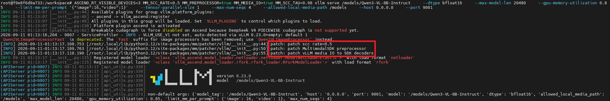

# Patcher

> **Introduction**: This section describes the feature switches that Multimodal SDK provides in vLLM. By setting the following environment variables, you can enable capabilities such as SCC visual token compression and preprocessing acceleration **without modifying the vLLM source code**.

---

## Common Prerequisites

Complete the following preparations before you use any of these features:

- Install Multimodal SDK.

> Multimodal SDK is automatically loaded as a vLLM plugin (vLLM scans the `mm.patcher.vllm` entry point at startup).

---

## Environment Variables

When vLLM starts, `mm.patcher.vllm.patch()` reads all the variables in the following table at one time and decides whether to activate the corresponding monkey patch.

| Environment Variable | Type | Value Range | Default Value | Description |
| --- | --- | --- | --- | --- |
| MM_SCC_RATE | float | (0, 1] | 1.0 | SCC visual token compression ratio. A value of 1.0 disables compression. The smaller the value, the fewer tokens are retained after compression and the faster the inference, but this may reduce accuracy. |
| MM_SCC_TAU | float | (0, 1] | 0.95 | The cosine similarity threshold for SCC partitioning. The higher the value, the stricter the merge conditions, the smaller the information loss, and the weaker the compression benefit. |
| MM_SCC_EPSILON | float | (0, 1) | 0.05 | The sampling error tolerance of the approximate Union-Find algorithm. This variable is used only on the CPU fallback path. |
| MM_SCC_MAX_TOKENS_PER_ITEM | int | [0, 65536] | 8192 | The upper limit on the number of tokens per sample. Samples that exceed this value **do not participate in SCC compression** and are sent directly to the LLM. A value of 0 means no limit. |
| MM_PREPROCESSOR | bool | `true`/`false` | `false` | Enables image and video preprocessing acceleration in the SDK (through `mm.core.processor.resize_and_normalize`). |
| MM_MEDIA_IO | bool | `true`/`false` | `false` | Enables video and image decoding acceleration in the SDK. |

If any variable is set to an invalid value, Multimodal SDK prints a warning in the vLLM log and falls back to the default value. It does not cause vLLM startup to fail.

### Disabling SDK Acceleration

- **Disable SCC visual token compression**: Set `MM_SCC_RATE=1.0` (or leave it empty to use the default value).
- **Disable preprocessing acceleration**: Set `MM_PREPROCESSOR=false` (or leave it empty).
- **Disable media decoding acceleration**: Set `MM_MEDIA_IO=false` (or leave it empty).

Disabling these features does not affect the startup of the vLLM service itself. It only stops the injection of the corresponding monkey patch.

---

## Applicable Models

After you set the preceding environment variables, SCC and preprocessing acceleration take effect automatically on the following models (when vLLM loads the corresponding model class, Multimodal SDK injects the monkey patch as needed):

| Model | SCC Visual Token Compression | Preprocessing Acceleration | Recommended `MM_SCC_RATE` |
| --- | --- | --- | --- |
| **Qwen2.5-VL-7B-Instruct** | ✓ | ✓ | 0.5 |
| **Qwen3-VL-8B-Instruct** | ✓ | ✓ | 0.6 |
| **Qwen3.6-35B-A3B** | ✓ | ✓ | 0.7 |
| **Qwen3.6-27B** | ✓ | ✓ | 0.6 |

Other models do not involve SCC or preprocessing patch operations. Therefore, they are not affected.

> **Media decoding acceleration (`MM_MEDIA_IO`) is model-agnostic**: This patch replaces the `VideoMediaIO` and `ImageMediaIO` media loading entry points of vLLM and works at the media decoding layer rather than on the model side. Therefore, it takes effect on **all models** and is not limited to the models listed in the preceding table.

---

## Version and Branch Mapping

Historically, Multimodal SDK has provided different patches for various versions of **vllm-ascend**. The vLLM entry APIs supported by different patches are incompatible with each other. Therefore, you need to check the corresponding branch.
This section describes only the models supported by each version and the accelerated parts. For details about SCC and preprocessing operations, see [Environment Variables](#environment-variables) and [Starting vLLM](#starting-vllm).

| Compatible vllm-ascend | Branch | Supported Models | Accelerated Parts |
| --- | --- | --- | --- |
| **v0.23.0** (default in this document) | `master` `release/v26.2.0` | Qwen2.5-VL · Qwen3-VL · Qwen3.5 · Qwen3.6 | SCC visual token compression (limited to the preceding models), image and video preprocessing acceleration (limited to the preceding models), and video and image decoding acceleration (all models) |
| **v0.8.5rc1** | `branch_v26.0.0` · `branch_v26.1.0` | Qwen2.5-VL · InternVL2 | Video decoding acceleration, and image preprocessing acceleration for Qwen2.5-VL and InternVL2 |

> **Scope of the feature description**: This document describes **only** vllm-ascend v0.23.0 on the `master` branch. The old patches for `branch_v26.x` versions use a different integration method. For details about their usage, see the `patcher.md` document in the corresponding branch.

---

## Starting vLLM

After you set the environment variables, **use the native `vllm serve` command directly**. No additional SDK-side parameters are required. For example, to run Qwen3-VL-8B-Instruct with SCC and preprocessing acceleration enabled:

```bash
MM_SCC_RATE=0.5 \
MM_SCC_TAU=0.95 \
MM_SCC_EPSILON=0.05 \
MM_SCC_MAX_TOKENS_PER_ITEM=8192 \
MM_PREPROCESSOR=true \
MM_MEDIA_IO=true \
vllm serve /models/Qwen3-VL-8B-Instruct \
    --host 0.0.0.0 \
    --port 9000
```

### Confirming That the Patch Takes Effect

In the startup log, if you can see any of the following lines near the beginning, the corresponding patch has been loaded:

| Log Keyword | Meaning |
| --- | --- |
| `patch scc rate=<value>` | SCC visual token compression has been injected (`MM_SCC_RATE < 1.0`) |
| `patch MultimodalSDK preprocessor` | Image and video preprocessing acceleration has been injected (`MM_PREPROCESSOR=true`) |
| `patch vLLM media IO to SDK decoders` | Media decoding acceleration has been injected (`MM_MEDIA_IO=true`) |

As shown in the following figure, the startup log contains a prompt line indicating that SCC visual token compression has been injected (`MM_SCC_RATE < 1.0`).



---

## File Requirements and Request Examples for Media Decoding Acceleration

After you set `MM_MEDIA_IO=true`, vLLM routes all video and image decoding to the SDK decoder (replacing `VideoMediaIO` and `ImageMediaIO`). The media files in requests must meet the following requirements:

| Media Type | Supported Format | Description |
| --- | --- | --- |
| Image | jpg/jpeg | Other formats (png, bmp, webp, and so on) are not supported by the SDK decoder. Therefore, the request returns an error. |
| Video | mp4 | Other containers (avi, mkv, mov, and so on) are not supported by the SDK decoder. Therefore, the request returns an error. |

Additional notes:

- To use `file://`, specify `--allowed-local-media-path` when you start vLLM to add the directory that contains the media files to the allowlist. Otherwise, vLLM denies access to local files. For example, if the media files are stored in the `/data` directory: `--allowed-local-media-path /data`.
- The permissions on media files must not be higher than 640.
- The patch layer verifies that the file exists. If the file does not exist, it reports an error directly and does not fall back to native decoding.

### Image Request Example

Send a request with an image through the OpenAI-compatible API. The `image_url` field uses the `file://` protocol to point to a local jpg or jpeg file on the server:

```bash
curl http://localhost:9000/v1/chat/completions \
    -H "Content-Type: application/json" \
    -d '{
        "model": "/models/Qwen3-VL-8B-Instruct",
        "messages": [
            {
                "role": "user",
                "content": [
                    {"type": "image_url", "image_url": {"url": "file:///data/images/dog.jpg"}},
                    {"type": "text", "text": "describe the content of this image"}
                ]
            }
        ]
    }'
```

### Video Request Example

Video requests use the `video_url` type, and also use the `file://` protocol to point to a local mp4 file on the server:

```bash
curl http://localhost:9000/v1/chat/completions \
    -H "Content-Type: application/json" \
    -d '{
        "model": "/models/Qwen3-VL-8B-Instruct",
        "messages": [
            {
                "role": "user",
                "content": [
                    {"type": "video_url", "video_url": {"url": "file:///data/videos/demo.mp4"}},
                    {"type": "text", "text": "describe the content of this video"}
                ]
            }
        ]
    }'
```

---

## Common Parameter Tuning

| Scenario | Recommended Adjustment |
| --- | --- |
| Noticeable accuracy drop | Tighten `MM_SCC_TAU` (for example, 0.98), or increase `MM_SCC_RATE` appropriately (for example, 0.7). |
| Need for more aggressive compression | Reduce `MM_SCC_RATE` (for example, 0.3). |

---

## References

- `MultimodalSDK/source/mm/patcher/vllm/__init__.py` — Plugin entry point and switch logic
- `MultimodalSDK/source/mm/patcher/vllm/constants.py` — Environment variable definition and validation
- `MultimodalSDK/source/mm/patcher/vllm/patch_media_io.py` — Media decoding acceleration patch (`VideoMediaIO` and `ImageMediaIO`)
- `MultimodalSDK/source/mm/core/scc/compressor.py` — SCC visual token compression algorithm
- `MultimodalSDK/source/mm/core/processor.py` — `resize_and_normalize` implementation
