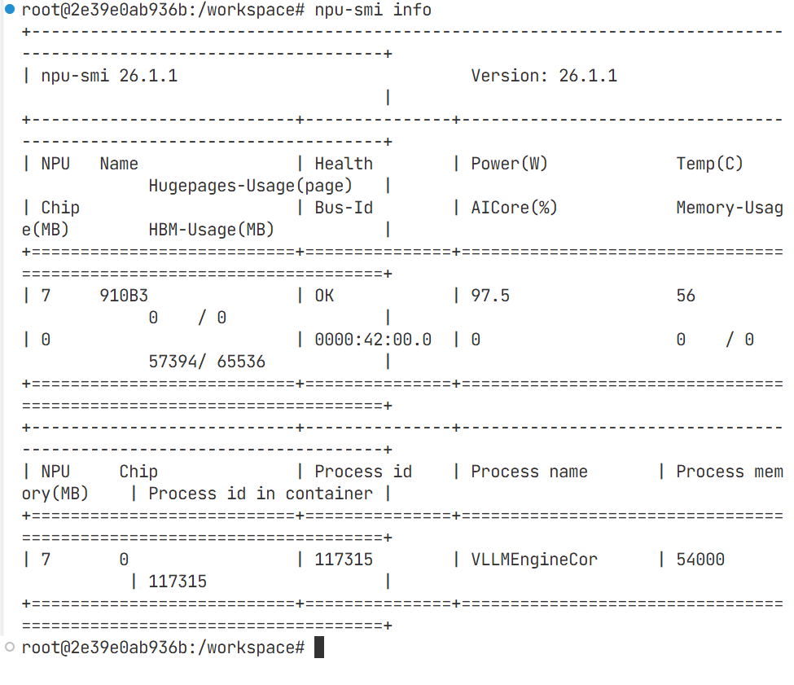
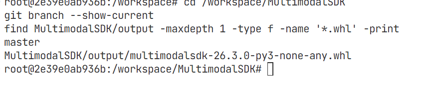
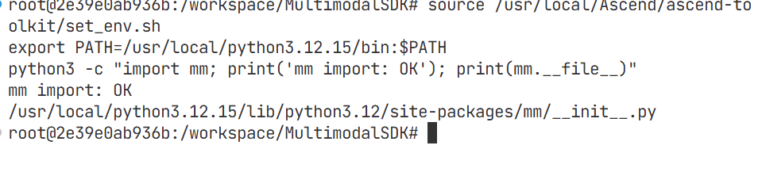
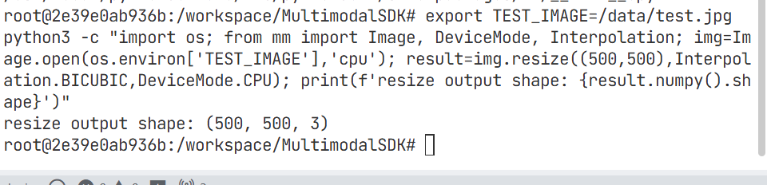
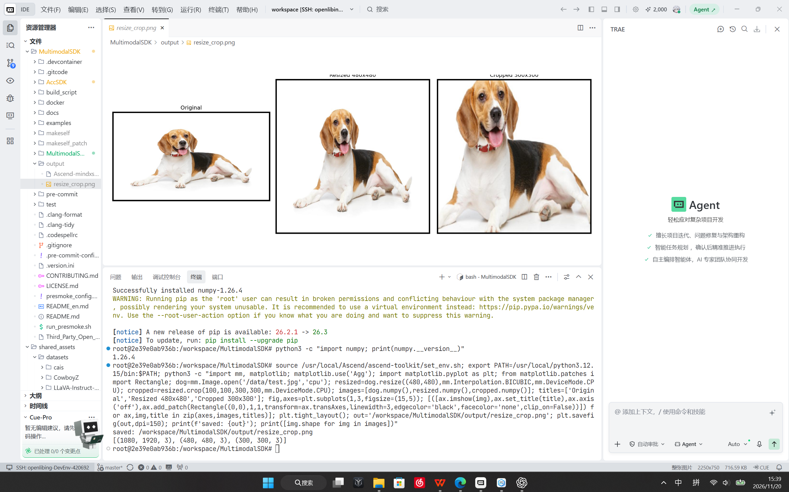
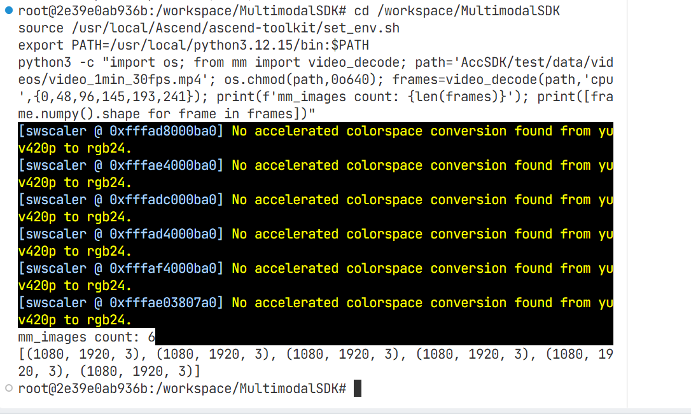
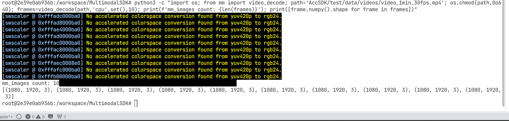
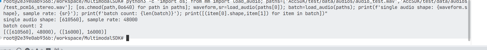
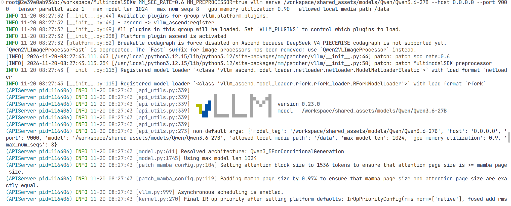
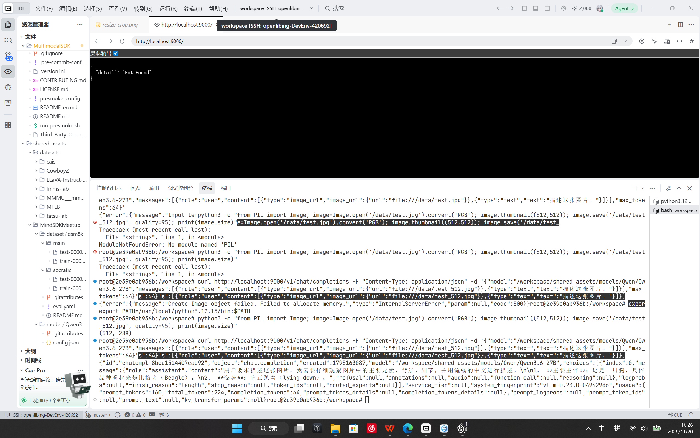

# 【MeetUp】MultimodalSDK 多模态功能验证总结报告

> **一句话结论**：在单张 Ascend 910B3 NPU 环境中完成 MultimodalSDK 源码构建、Wheel 安装、图像/视频/音频样例及 Qwen3.6-27B vLLM SCC 压缩验证；SCC 开启后同一图片请求的 `prompt_tokens` 从 160 降至 103，减少 57 个（35.6%）。关键阻塞点：当前容器仅挂载 1 张 NPU，无法按任务书完成 4 卡验证；经单卡参数调整后完成验证。

## 1 文档信息

| 项目 | 内容 |
| --- | --- |
| 文档类型 | 验证报告 |
| 提交人 | GitCode ID：`<gcw_1Lmbo4j5>` |
| 文档版本 / 日期 | v1 / 2026-11-20 |
| 代码分支 | `master` |
| SDK Wheel | `multimodalsdk-26.3.0-py3-none-any.whl` |

## 2 任务背景与目标

在 Ascend NPU 容器中，根据 MultimodalSDK 当前 `master` 分支文档完成源码构建和 Wheel 安装，验证图像 resize/crop、视频帧解码、音频加载及 vLLM 集成中的 SCC 视觉 token 压缩能力。

## 3 环境准备

### 3.1 环境信息

- NPU：Ascend 910B3，当前容器可见 1 张卡（NPU 7），健康状态为 `OK`。
- Python：3.12.15。
- vLLM：0.23.0+empty，Ascend 插件正常加载。
- 模型：`/workspace/shared_assets/models/Qwen/Qwen3.6-27B`。



### 3.2 源码构建与安装

执行以下流程：

```bash
git clone --branch master https://gitcode.com/Ascend/MultimodalSDK.git
cd /workspace/MultimodalSDK
source /usr/local/Ascend/ascend-toolkit/set_env.sh
export PATH=/usr/local/python3.12.15/bin:$PATH
export PYTHON3_EXECUTABLE="$(command -v python3)"
bash build_script/build_merge.sh
pip3 install --force-reinstall --no-deps MultimodalSDK/output/multimodalsdk-26.3.0-py3-none-any.whl
python3 -c "import mm; print('mm import: OK'); print(mm.__file__)"
```

构建生成 Wheel 并完成安装，`mm import: OK`。





## 4 实际执行步骤

### 步骤 1 基础图像 resize 验证

使用 `/data/test.jpg` 读取图像并在 CPU 模式下 resize 到 500 x 500。

```bash
export TEST_IMAGE=/data/test.jpg
python3 -c "import os; from mm import Image, DeviceMode, Interpolation; img=Image.open(os.environ['TEST_IMAGE'],'cpu'); result=img.resize((500,500),Interpolation.BICUBIC,DeviceMode.CPU); print(f'resize output shape: {result.numpy().shape}')"
```

结果：`resize output shape: (500, 500, 3)`。



### 步骤 2 图像 resize/crop 可视化

将原图 resize 到 480 x 480，再裁剪为 300 x 300，保存三联对比图。

结果：原图 `(1080, 1920, 3)`，resize 图 `(480, 480, 3)`，crop 图 `(300, 300, 3)`。



### 步骤 3 视频帧解码

先通过 `git lfs pull` 拉取 `AccSDK/test/data/videos/video_1min_30fps.mp4`，再验证两种解码方式：

- 指定帧集合 `{0, 48, 96, 145, 193, 241}`：返回 6 帧，均为 `(1080, 1920, 3)`。
- 空帧集合并设置 `sample_num=10`：均匀采样返回 10 帧，均为 `(1080, 1920, 3)`。





### 步骤 4 音频加载

以 `audio_test.wav` 进行单文件加载，并以 `audio_test.wav`、`test_pcm16_stereo.wav` 进行批量加载。

结果：单文件波形尺寸 `[610560]`、采样率 `48000`；批量返回 2 条音频，采样率分别为 `48000` 和 `16000`。



### 步骤 5 vLLM SCC 视觉 token 压缩对比

使用 Qwen3.6-27B 与同一张缩放后的测试图片 `/data/test_512.jpg`，在单卡上限制并发为 8：

```bash
MM_SCC_RATE=1.0 MM_PREPROCESSOR=true vllm serve /workspace/shared_assets/models/Qwen/Qwen3.6-27B --host 0.0.0.0 --port 9000 --tensor-parallel-size 1 --max-model-len 1024 --max-num-seqs 8 --gpu-memory-utilization 0.90 --allowed-local-media-path /data
```

关闭压缩时 `MM_SCC_RATE=1.0`；开启压缩时使用 `MM_SCC_RATE=0.6`。两次请求使用相同的 `/v1/chat/completions` 调用、图片和文本提示。

| 模式 | `prompt_tokens` | `completion_tokens` | `total_tokens` |
| --- | ---: | ---: | ---: |
| 未开启压缩 | 160 | 64 | 224 |
| 开启 SCC 压缩，`MM_SCC_RATE=0.6` | 103 | 64 | 167 |

结论：开启 SCC 后 `prompt_tokens` 减少 57，降幅为 35.6%。





## 5 执行结果

结论：**通过（单卡验证范围）**。

- 源码构建、Wheel 安装和 `mm` 导入通过。
- 图像 resize/crop、视频指定帧解码、视频均匀采样、音频单文件及批量加载均通过。
- Qwen3.6-27B vLLM SCC 压缩对比通过，`prompt_tokens` 从 160 降至 103。
- 任务书要求的 4 卡环境未满足；本次基于单卡完成验证，不将结果等同于 4 卡性能结论。

## 6 发现的问题

已发现并建议提交 1 个文档问题：图片处理可视化示例直接依赖 `matplotlib`，但安装部署文档的依赖清单未列出该依赖。在干净环境执行示例会出现 `ModuleNotFoundError: No module named 'matplotlib'`。

Issue：`【MeetUp】图片处理可视化示例未声明 matplotlib 依赖`，提交后请将链接替换为：`<Issue URL>`。

## 7 总结

1. 当前 `master` 分支可以完成 MultimodalSDK 源码构建，并生成、安装 `multimodalsdk-26.3.0` Wheel。
2. 图像、视频和音频基础能力均按预期返回正确的图像尺寸、帧数或音频采样率。
3. 单卡运行 51.08 GB 模型权重后可用 KV Cache 较小，需将 `--max-num-seqs` 限制为 8 才能完成 vLLM 初始化。
4. SCC 压缩在相同图片请求中将输入 token 从 160 降至 103，验证了压缩功能生效。

## 8 体验总结

| 维度 | 评价 | 说明 |
| --- | --- | --- |
| 文档易懂度 | 一般 | 基础样例清晰，但图片可视化样例未声明 matplotlib 依赖。 |
| 流程顺畅度 | 一般 | 源码构建可完成；单卡运行 Qwen3.6-27B 需要根据 KV Cache 报错增加 `--max-num-seqs 8`。 |
| 报错可读性 | 好 | vLLM 错误明确指出 `max_num_seqs` 超出可用 Mamba Cache 块数，并给出了限制为 8 的修复方向。 |
| 整体评价 | 4 / 5 | 功能验证路径完整，依赖声明和单卡资源说明仍可进一步完善。 |

- 最耗时的一步：Qwen3.6-27B vLLM 首次加载和编译，约 5 分钟。
- 最值得改进的点：为需要展示图片的示例在依赖列表中补充 `matplotlib`，或在样例前给出明确安装提示。
